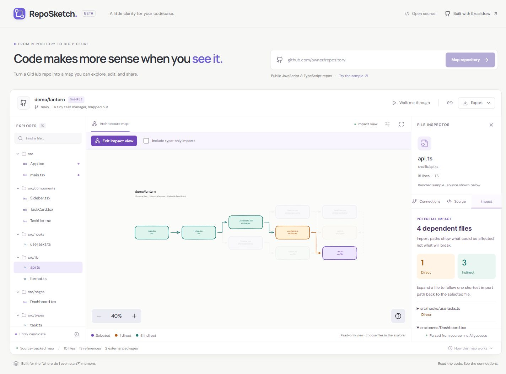

# RepoSketch

**See the bigger picture of a codebase.**

[](https://github.com/TejeshDevdas/reposketch/actions/workflows/ci.yml)
[](LICENSE)

Paste a public GitHub repository URL and get an editable map of its JavaScript and TypeScript imports. Explore connections, read the source behind an arrow, follow a guided route through the code, and export your annotated diagram.

Built with React, TypeScript, Vite, and [Excalidraw](https://github.com/excalidraw/excalidraw). MIT licensed.



**A useful first click:** open the bundled sample, select `src/lib/api.ts`, and choose **What depends on this?** The map reveals one direct dependent and three indirect dependents, with source evidence for each path.

## Run locally

Requires **Node.js 22.12 or newer** and npm.

```sh
git clone https://github.com/TejeshDevdas/reposketch.git
cd reposketch
npm ci
npm run dev
```

Open [localhost:3000](http://localhost:3000). No GitHub account, token, or AI API key is required. On Windows, use `npm.cmd` if PowerShell blocks the `npm.ps1` wrapper.

The initial **Lantern** sample is an original, fictional React task manager included in `server/demo.ts`. Its diagram and source work without network access. It does not pretend to be an external GitHub repository.

To run a production build:

```sh
npm run build
npm start
```

`PORT` changes the port; `HOST` defaults to `127.0.0.1`. Keep that default for local use. The development server updates client files live; restart it after changing server files.

## What you can do

- Analyze `https://github.com/owner/repository` or `owner/repository` on its current default branch.
- Search the file explorer without changing your drawing.
- Select a file to inspect local imports, incoming references, external imports, and unresolved references.
- Choose **What depends on this?** to highlight the selected file in purple, direct dependents in amber, and indirect dependents in teal. Expand results in the **Impact** tab for a shortest import path with source-line evidence. Type-only imports are optional and excluded by default.
- Click an import's line number to see it highlighted in the source.
- Follow **Walk me through** for up to eight files reachable from a candidate entry point.
- Move cards, add text and annotations, or draw new shapes. Arrows stay bound to the file cards.
- Toggle drawing style controls with the sliders icon above the canvas.
- Export the **current edited scene** as PNG or an editable `.excalidraw` file. Open the latter in [Excalidraw](https://excalidraw.com).
- Copy a repository permalink. This re-analyzes the default branch on the receiving instance; canvas edits and the original commit are **not** included. A localhost link works only for someone running the application locally.

Canvas edits are held in the current browser session, not automatically saved. Export before refreshing, switching repositories, or closing the tab. Analysis is cached in server memory for five minutes, up to four repositories.

Impact mode is a temporary, read-only view. Choose another file in the explorer to change its starting point, or use **Locate on map** to focus a dependent without changing the analysis. Exit the view (or press Escape) to restore your edited drawing. Exports made in impact mode include its highlighting. Counts cover analyzed, resolved imports only; potential impact does not mean a change will cause a runtime failure.

## What the arrows mean

The TypeScript compiler API parses imports; there is no AI inference. Arrows run from the importing file to the imported file. A dashed arrow represents type-only dependencies. Several imports between the same pair of files share a single arrow; the inspector lists every reference and line number. Self-imports are listed in the inspector but are not drawn as arrows.

This is a **static dependency map**, not a runtime trace or a full architectural interpretation. Entrypoints are candidates based on package `source`, `main`, `module`, `bin`, and conventional filenames. Tests and examples are included when they contain supported source files.

Supported source: `.js`, `.jsx`, `.ts`, `.tsx`, `.mjs`, `.cjs`, `.mts`, `.cts`. The analyzer finds static imports, re-exports, literal dynamic imports, `require()` calls, `import = require()`, and type import expressions. Relative paths, extension substitution, directory indexes, and nearest `tsconfig.json` / `jsconfig.json` `baseUrl` and `paths` are supported.

### Current limits

- Public repositories, default branch only. Branch, file, and subfolder URLs are rejected.
- Up to **250 source files**, **512 KiB per analyzed file**, **12 MiB compressed archive**, **40 MiB expanded archive**, and **10,000 archive entries**. Oversized repositories are rejected rather than silently truncated.
- Dependency folders, build outputs, hidden directories, and declaration files are excluded.
- Inherited and referenced TypeScript configurations are not loaded; a note explains the limitation. Workspace package resolution and bundler-specific aliases may be incomplete. Unrecognized bare imports are classified as external candidates, not verified installed packages.
- Computed imports cannot be resolved. Assets, generated modules, and unsupported aliases appear as unresolved references.
- Source links use the exact commit SHA analyzed. A later repository change cannot silently change the linked source.
- GitHub's unauthenticated API rate limits apply. Error messages preserve the last useful diagram.

## Architecture

```text
React workbench → POST /api/analyze → GitHub metadata + pinned archive
                                          ↓
                                bounded in-memory reader
                                          ↓
                                TypeScript AST / resolver
                                          ↓
                               file graph + source evidence
                                          ↓
                               editable Excalidraw canvas
```

`server/analyze.ts` is a pure analyzer over an in-memory path/text map. `server/archive.ts` enforces archive limits without extracting files to disk. `server/github.ts` fetches only fixed GitHub API and codeload URLs. `server/app.ts` provides the HTTP boundary, cache, and static serving. `src/components/Diagram.tsx` owns the canvas and exports; `src/components/Inspector.tsx` presents source evidence.

Downloaded code is never installed, imported, or executed. Source previews are rendered as text. The server limits analysis concurrency to two and rejects cross-origin analysis requests. The app is intended for local use; internet hosting would require authentication or abuse controls and deployment-specific rate limiting.

## Development

```sh
npm test             # parser, resolution, archives, HTTP, and layout tests
npm run typecheck    # TypeScript
npm run build        # typecheck + production assets
npm run format      # format source and documentation
```

See [CONTRIBUTING.md](CONTRIBUTING.md) and the [release history](CHANGELOG.md). Dependency versions are locked in `package-lock.json`.

The `overrides` in `package.json` select patched transitive versions of Nano ID, Sass, lodash-es, and KaTeX while keeping Excalidraw 0.18.1. Review these overrides when updating Excalidraw or its Mermaid integration.

## Credits

- [Excalidraw](https://github.com/excalidraw/excalidraw): drawing canvas and exports (MIT).
- [TypeScript](https://github.com/microsoft/TypeScript): syntax parsing and resolution (Apache-2.0).
- [Lucide](https://lucide.dev): icons (ISC).
- DM Sans and Manrope: bundled through Fontsource (SIL Open Font License).

## License

[MIT](LICENSE). Third-party packages retain their respective licenses.
